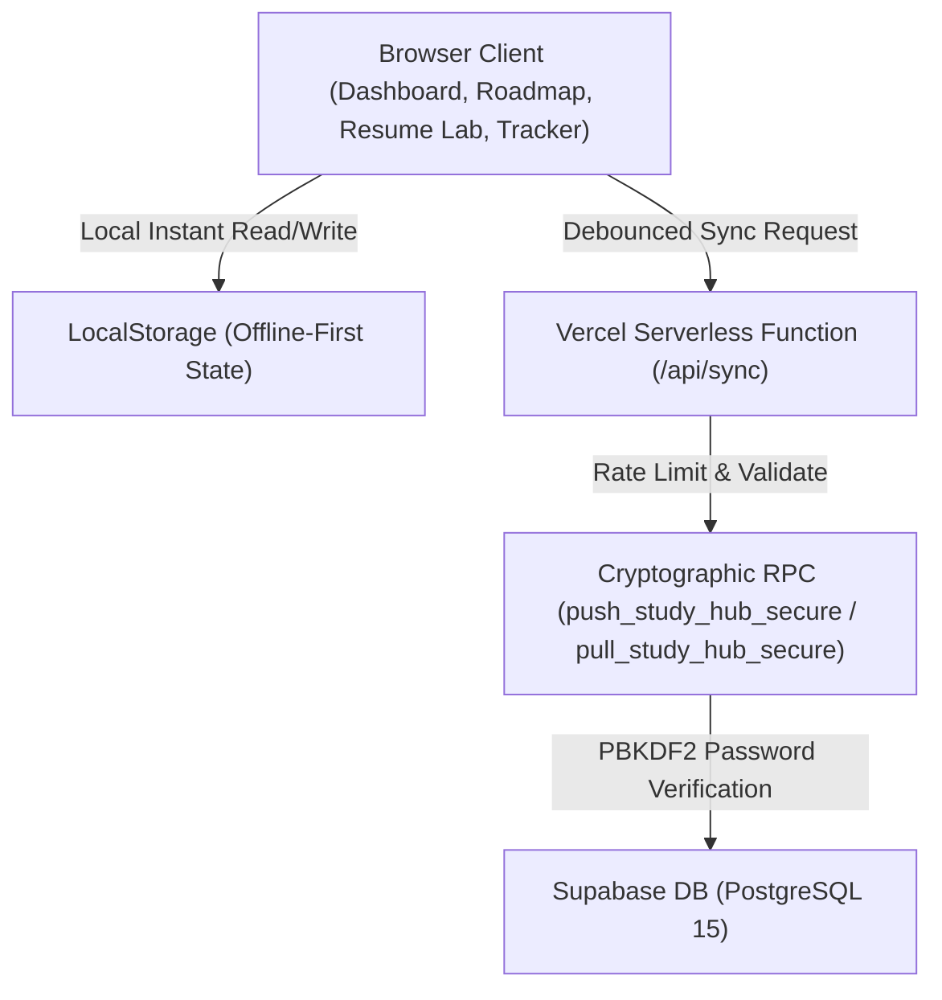

<div align="center">

# ⚡ AI & Machine Learning Engineer Hub
### *The 22-Week Tactile Production Blueprint & Interactive Curriculum*

[](https://ai-ml-study-hub.vercel.app/)
[](https://supabase.com)
[](https://tailwindcss.com)
[](https://python.org)
[](#-security--cryptographic-sync)

<p align="center">
  A state-of-the-art interactive study lab designed for self-directed engineers transforming into production-grade AI/ML Engineers over a structured 5-month journey.
</p>

[**Explore Live Hub**](https://ai-ml-study-hub.vercel.app/) • [**Download Master Plan (PDF)**](AI_ML_Engineer_Full_5_Month_Master_Plan.pdf) • [**Report an Issue**](https://github.com/Neeraj3102/ai-ml-study-hub/issues)

---

</div>

## 🌌 Master Themes: Dual Aesthetic Engine

Switch seamlessly between two handcrafted, high-fidelity design languages with 100% WCAG contrast across all screens:

```
┌───────────────────────────────────────────────┬───────────────────────────────────────────────┐
│              🌙 CYBER MASTER BLEND            │                 ☀️ SOFT CLAY                  │
├───────────────────────────────────────────────┼───────────────────────────────────────────────┤
│ • 60 FPS Living Aurora Mesh Background        │ • Tactile Neumorphic Insets & Soft Clay Glow   │
│ • Deep Acrylic Glassmorphism (Blur 16px)      │ • Crisp Charcoal & Deep Jewel Accent Tones    │
│ • Interactive Radial Cursor Spotlight         │ • High-Legibility Daytime Focus Mode          │
└───────────────────────────────────────────────┴───────────────────────────────────────────────┘
```

---

## ⚡ Core Platform Capabilities

### 1. 🎯 Active Day Command Box & Syllabus Breakdown
- **Daily Focus View**: Highlights that day's active video lesson, difficulty rating, estimated study time, and exact Git repository file path.
- **Syllabus & Concept Tags**: Interactive breakdown of every core concept covered today with granular pills.
- **Reflection Journal**: Auto-saving local scratchpad to record lesson doubts, tricky edge cases, and topics that need future revision.
- **Instant Undo Tick**: Completed a task by accident? Click once to undo without losing momentum or statistics.

### 2. 🛠️ Daily Scratch Revision Projects (15–30 Min)
- Designed for **all 143 curriculum lessons**.
- Rather than just passive watching, every lesson provides a self-contained, hands-on micro-project to build from scratch.
- Features a **3-step revision checklist** (Setup, Core Logic, Verification) to cement theoretical concepts into muscle memory immediately.

### 3. ⏱️ Adaptive Rolling Engine & Drift Control
*Zero guilt when life gets in the way.*
- **Shift Everything +1 Day**: Pushes remaining deadlines forward without manual rescheduling.
- **Absorb into Buffer**: Uses 1 of your **18 pre-budgeted weekend buffer days**, guaranteeing your graduation date stays locked on **April 4, 2027**.
- **↩️ 1-Click Undo (-1 Day)**: Accidentally postponed? Revert the calendar shift with one click.
- **↺ Safety Drift Reset**: Instantly restore schedule baseline back to Day 0.

### 4. 💼 Resume Lab (15 Production Portfolio Projects)
- 15 piece-by-piece resume builders covering every tier of your AI engineering education:
  1. **Software Engineering Core**: Developer CLI Automation Suite, Concurrent Asynchronous Web Scraper, High-Throughput REST API Microservice.
  2. **Math, Data & Classic ML**: Vectorized Linear Algebra & Matrix Engine, Exploratory Statistical Data Analysis Lab, Production Churn Prediction Engine with Model Monitoring.
  3. **Deep Learning & Computer Vision**: Neural Network from Scratch (NumPy Forward/Backward Pass), Transfer Learning Vision Pipeline (FastAPI Inference), Transformer Multi-Head Self-Attention from Scratch.
  4. **NLP, LLMs & Vector RAG**: Tokenizer & BPE Engine from Scratch, Production Hybrid Vector RAG Knowledge Base, Low-Latency LLM Serving Microservice with vLLM & Streaming.
  5. **Multi-Agent Systems & Deployment**: Autonomous Multi-Agent Research Assistant (LangGraph), Private Edge AI & Model Distillation Suite, **⭐ Flagship Production Capstone**.
- Each project card includes:
  - Technical requirements checklist
  - Web App UI guide (Streamlit / Textual / Gradio)
  - Concepts applied breakdown
  - **Copy-Paste Resume Action Bullets**

### 5. 🔐 Zero-Exposed-Secrets Cloud Synchronization
- **End-to-End Credential Abstraction**: No API keys, database URLs, or passwords exist in frontend client code.
- **Cryptographic User Authentication**: User-chosen Sync IDs and secret passcodes are hashed using PBKDF2/SHA-256 inside Supabase RPC procedures (`push_study_hub_secure`, `pull_study_hub_secure`).
- **Serverless Rate Limiting**: Vercel API proxy (`/api/sync`) restricts requests to 30 calls/minute per IP.
- **Resilient Fallback**: Operates entirely offline via browser `localStorage` if sync is disconnected.

---

## 🗺️ 22-Week Curriculum Roadmap Overview

| Phase | Duration | Core Focus & Milestones | Daily Lessons |
| :--- | :--- | :--- | :--- |
| **Phase 1: Software Engineering Core** | Weeks 1–5 | Python 3.13, Data Structures, OOP, Memory Management, Linux CLI, Git & FastAPI. | Days 1–35 |
| **Phase 2: Math, Data & Classic ML** | Weeks 6–10 | Linear Algebra, Multivariable Calculus, NumPy, Pandas, Scikit-Learn, XGBoost, MLOps. | Days 36–70 |
| **Phase 3: Deep Learning & Vision** | Weeks 11–14 | Backpropagation, PyTorch, CNNs, Transfer Learning, Vision Transformers (ViT). | Days 71–98 |
| **Phase 4: LLMs, RAG & Agents** | Weeks 15–18 | Attention Mechanisms, Tokenization, Qdrant/Pinecone RAG, Quantization (GGUF), LangGraph. | Days 99–126 |
| **Phase 5: Production Deployment & Career** | Weeks 19–22 | MCP (Model Context Protocol), Docker, Kubernetes, Triton/vLLM, Resume Overhaul & Interviews. | Days 127–143 |

*Total: 22 Weeks • 143 Daily Lessons • 18 Pre-Budgeted Buffer Days • 15 Portfolio Projects*

---

## 🚀 Quick Start (Local Setup)

```bash
# 1. Clone the repository
git clone https://github.com/Neeraj3102/ai-ml-study-hub.git
cd ai-ml-study-hub

# 2. Serve locally with any static server
# Using Python:
python -m http.server 3000

# Using Node (npx):
npx serve .
```

Open your browser at `http://localhost:3000`.

---

## 🛠️ Tech Stack & Architecture



- **Frontend**: Vanilla HTML5, Modern ECMAScript (ES2024), Tailwind CSS
- **Typography**: Plus Jakarta Sans (Headings/Body) + JetBrains Mono (Code/Metadata)
- **Deployment**: Vercel Serverless Functions (`/api/sync.js`)
- **Database**: Supabase PostgreSQL with Row-Level Security (RLS) & Stored Functions

---

## 📄 License & Attribution

Designed and maintained by [Neeraj3102](https://github.com/Neeraj3102).  
Curriculum curated from world-class engineering resources: *CampusX*, *CodeWithHarry*, *Harvard CS50*, *3Blue1Brown*, *Fast.ai*, and *Andrej Karpathy*.

Licensed under the [MIT License](LICENSE).
